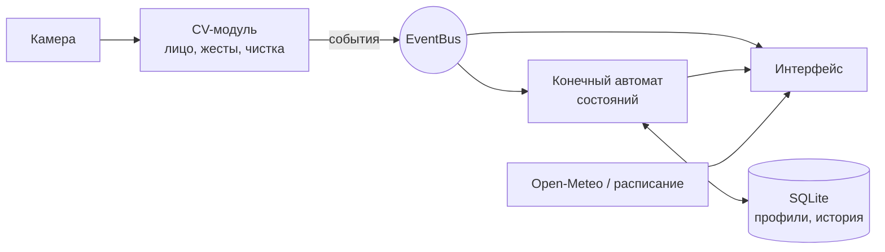
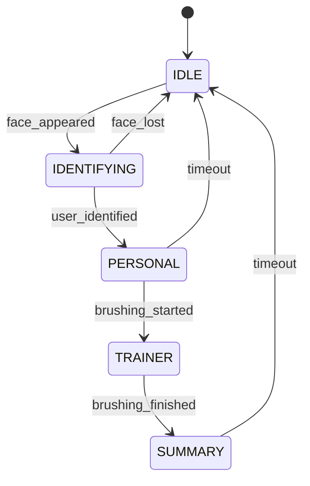

# Архитектура системы «Умное зеркало»

## 1. Модули

Модули не вызывают друг друга напрямую: CV публикует события в `EventBus`,
автомат состояний и интерфейс на них подписаны.

## 2. Конвейер обработки кадра (раздел 5.1 ТЗ)

1. Захват кадра и отражение по горизонтали
2. Предобработка: размер, коррекция освещения
3. Лицо и ключевые точки (MediaPipe Face Mesh)
4. Вектор признаков лица и сравнение с профилями (косинусное сходство)
5. Кисти и ключевые точки (MediaPipe Hands)
6. Жесты (обычный режим) или анализ чистки (режим тренера)
7. Публикация событий

## 3. События

| Событие | Payload | Кто публикует |
|---|---|---|
| `face_appeared` | – | CV |
| `face_lost` | – | CV |
| `user_identified` | `profile` (имя или `guest`) | CV |
| `gesture` | `name` | CV |
| `brushing_started` | – | CV или жест |
| `brushing_zone` | `zone`: `upper_left`, `upper_right`, `lower_left`, `lower_right` | CV |
| `brushing_paused` | – | CV (движения нет > 5 с) |
| `brushing_resumed` | – | CV (движение возобновилось) |
| `brushing_finished` | – | логика тренера |
| `timeout` | – | логика приложения (по умолчанию 15 с без лица) |

## 4. Диаграмма состояний

В состоянии `TRAINER` событие `timeout` игнорируется: пропажа лица во время
чистки не должна прерывать тренер (реализовано и проверено в
`tests/test_state_machine.py`).

## 5. Выбор технологий (черновик обоснования для отчёта)

| Задача | Выбор | Почему |
|---|---|---|
| Лицо и руки | MediaPipe | Готовые модели, работают на CPU, ключевые точки лица и кисти в одном пакете |
| Идентификация | OpenCV YuNet (детектор) + SFace (вектор 128) | Входит в OpenCV, без dlib и PyTorch, работает на CPU, на Windows с новым Python ставится без сборки |
| Чистка зубов | Положение кисти относительно рта (MediaPipe) и колебания руки | Щётка на веб-камере мелкая и закрыта рукой; YOLO оставлен как возможное усиление, если точность зон не достигнет цели |
| Интерфейс | Pillow поверх кадра OpenCV | Кириллица, полупрозрачные карточки, без отдельного GUI-фреймворка |
| Хранилище | SQLite | Один файл, без сервера, достаточно для 2–4 профилей |
| Конфигурация | YAML | Все пороги в одном месте |
